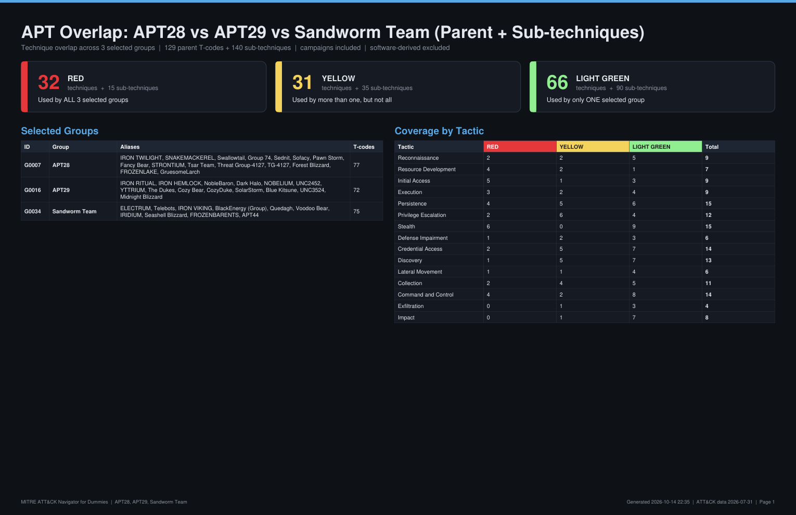
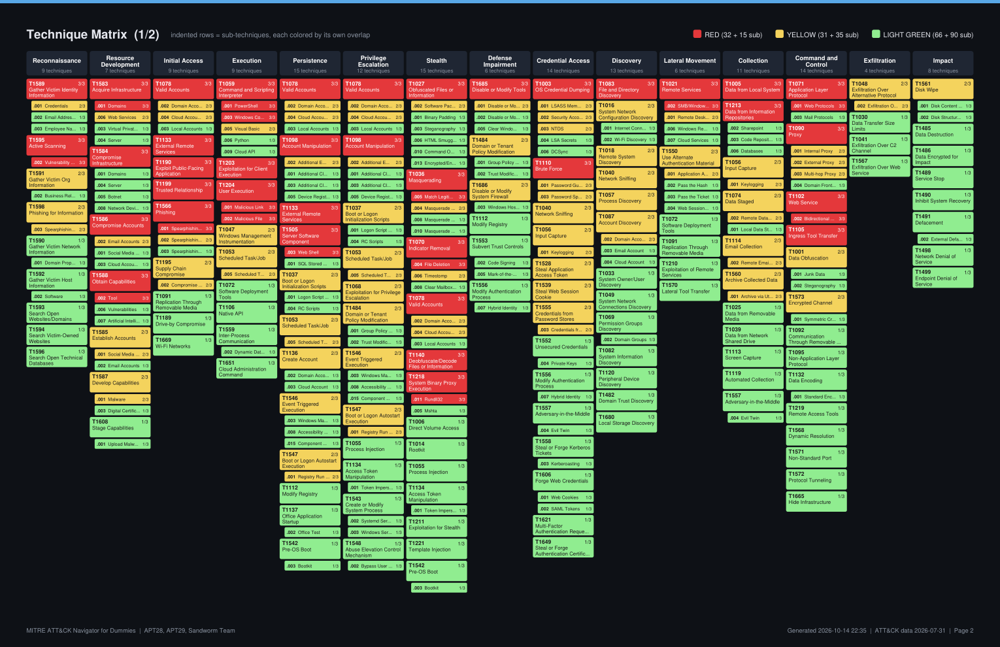

# MITRE ATT&CK Navigator for Dummies

Pick a few APT groups and get a color-coded ATT&CK overlap map with no clicking around in the Navigator.

The tool pulls the latest MITRE ATT&CK data for the **Enterprise** matrix (the default), or for **Mobile** or **ICS** if you ask for it. It finds every technique (T-code) the selected groups are documented as using, and colors each one by how many of the groups share it:

The color scale adapts to how many groups you pick. Light green always means one group. The more groups you pick, the more steps there are between "one group" and "all of them":

| Groups picked | 🟩 LIGHT GREEN | 🟨 YELLOW | 🟧 ORANGE | 🟥 RED | ⬛ DARK RED |
|---|---|---|---|---|---|
| 1 | 1 | | | | |
| 2 | 1 | | | 2 (both) | |
| 3 | 1 | 2 | | 3 (all) | |
| 4 | 1 | 2 | 3 | 4 (all) | |
| 5 | 1 | 2 | 3 | 4 | 5 (all) |
| 6 | 1 | 2–3 | 4 | 5 | 6 (all) |
| 7 | 1 | 2–3 | 4–5 | 6 | 7 (all) |
| 8 | 1 | 2–3 | 4–5 | 6–7 | 8 (all) |
| 10 | 1 | 2–4 | 5–7 | 8–9 | 10 (all) |

The numbers are how many of the selected groups use a technique. From 5 groups up, the counts between 1 and "all" are split into three near-equal bands (yellow, orange, red), and dark red is kept for techniques that **every** selected group uses. Each report, layer legend and console run prints the exact scale used.

Only techniques that at least one selected group has used are shown. Everything else is left out, both in the reports and in the Navigator layer.

## What you get

Every run creates two sets of outputs:

```
output/<timestamp>_<groups>/
├── 1_Parent_Only/       parent T-codes only (sub-technique use rolled up into the parent)
│   ├── <groups>_parent-only_layer.json
│   ├── <groups>_parent-only.xlsx
│   └── <groups>_parent-only.pdf
└── 2_Parent_and_Sub/    parent T-codes + the sub-techniques used, each with its own color
    ├── <groups>_parent-and-sub_layer.json
    ├── <groups>_parent-and-sub.xlsx
    └── <groups>_parent-and-sub.pdf
```

* **`_layer.json`**: an ATT&CK Navigator layer. Unused techniques are hidden. In the parent-and-sub layer, sub-techniques expand under their parents.
* **`.xlsx`**: an Excel workbook with three sheets:
  * **Summary**: groups, color legend and counts per tactic.
  * **Technique Overlap**: one row per technique with a ✔ per group. Filterable, and sub-technique rows can be collapsed.
  * **Tactic Matrix**: a Navigator-style grid.
* **`.pdf`**: a dark-themed report with a summary page, the color-coded matrix and a detail table.

A full example for APT28, APT29 and Sandworm Team is in [`examples/`](examples/APT28_APT29_Sandworm).




## Quick start (Windows, no command line needed)

1. Install [Python 3.10+](https://www.python.org/downloads/) and tick **"Add python.exe to PATH"**.
2. Download or clone this repo.
3. Double-click **`Run ATTACK Overlap.bat`**.
4. Pick the matrix: just press **Enter** for Enterprise, or type `mobile` or `ics`.
5. Type your groups, separated by commas. You can use names, aliases or G-IDs:
   ```
   Groups> APT28, Cozy Bear, G0034
   ```
6. Confirm. The output folder opens automatically.

The first run of each matrix downloads its ATT&CK dataset into `data/` (Enterprise is about 50 MB). Later runs reuse it.

Interactive commands:

| Command | Does |
|---|---|
| `list` | show every group |
| `find bear` | search names and aliases |
| `quit` | exit |

## Command line

```bash
pip install -r requirements.txt
```

Enterprise is the default. Put `mobile` or `ics` first to use one of those matrices instead:

```bash
python attack_overlap.py APT29 "Aquatic Panda" APT1                 # Enterprise
python attack_overlap.py mobile APT28 APT-C-23 Windshift            # Mobile
python attack_overlap.py ics "Sandworm Team" ALLANITE APT33         # ICS
```

Names don't need exact spacing or capitals (`AquaticPanda` works). Not every group appears in every matrix. To see which groups a matrix has, use `python attack_overlap.py mobile --list`.

| Option | Description |
|---|---|
| `--mode both\|parents\|subs` | which output set(s) to build (default `both`) |
| `--no-campaigns` | ignore techniques from campaigns attributed to the groups (included by default, same as attack.mitre.org) |
| `--include-software` / `--no-software` | count (or don't count) techniques of the malware and tools each group uses. Off by default for Enterprise, on by default for Mobile and ICS, where ATT&CK links most groups to techniques through their malware |
| `--update` | re-download the latest ATT&CK data before running |
| `--list` / `--search TEXT` | list or search the groups in the chosen matrix, then exit |
| `--title "..."` | custom report title |
| `--out DIR` | custom output folder |

## Loading the layer in ATT&CK Navigator

1. Open <https://mitre-attack.github.io/attack-navigator/>.
2. Choose **Open Existing Layer**, then **Upload from local**.
3. Pick the `_layer.json` file.

Hover over a technique to see which groups used it. The legend shows the color key.

## How overlap is calculated

* A group "uses" a technique if ATT&CK has a `uses` relationship from the group, or from a campaign attributed to it, to that technique or one of its sub-techniques.
* **Parent T-codes**: any sub-technique use counts toward its parent. For example, T1059.001 counts as T1059.
* **Sub-techniques** (in the parent-and-sub outputs) are scored on their own. A parent can be RED while some of its sub-techniques are a lower color.
* Revoked and deprecated objects are ignored.
* If only one group is selected, everything it uses is LIGHT GREEN.
* Each run uses one matrix. The output folder and file names start with it (`Enterprise_`, `Mobile_` or `ICS_`), and the layer opens in the matching Navigator matrix.

## Data and attribution

This tool uses the [MITRE ATT&CK®](https://attack.mitre.org/) dataset from [mitre/cti](https://github.com/mitre/cti).
ATT&CK® is a registered trademark of The MITRE Corporation, used under MITRE's [Terms of Use](https://attack.mitre.org/resources/legal-and-branding/terms-of-use/).
This project is not affiliated with or endorsed by MITRE.
